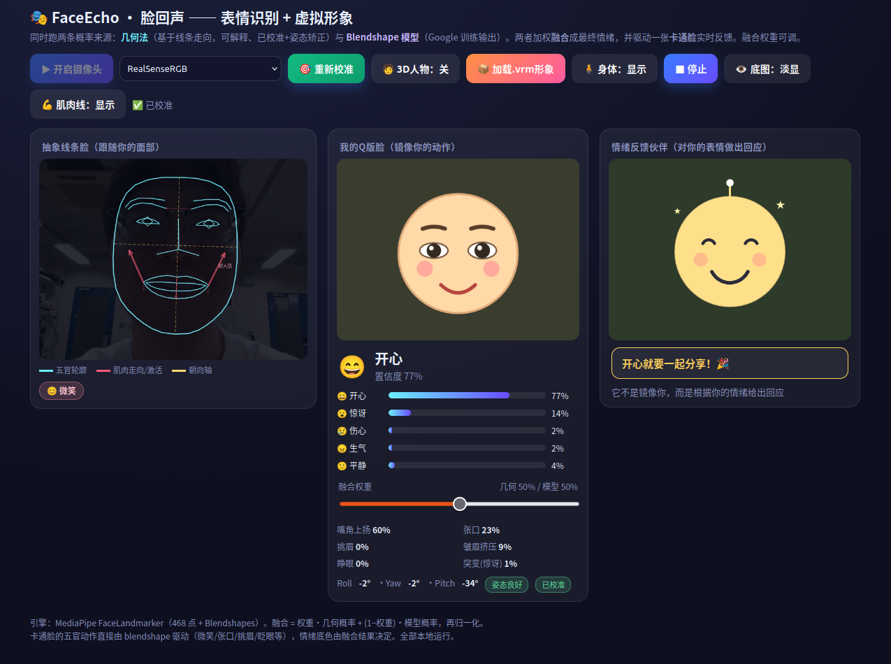
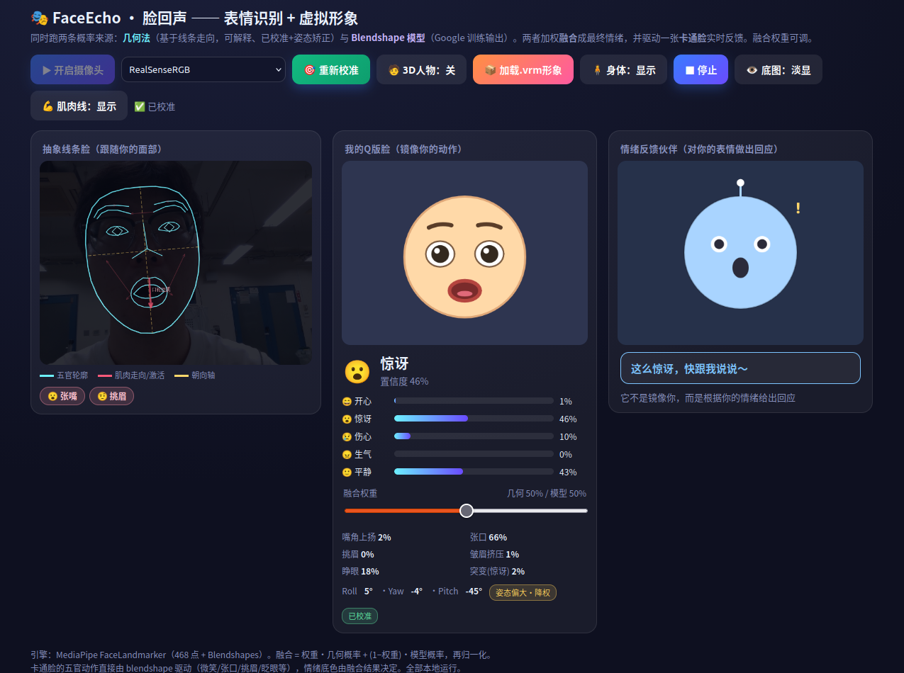
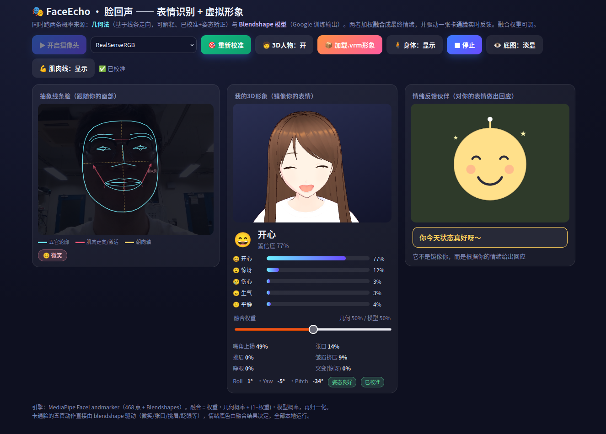
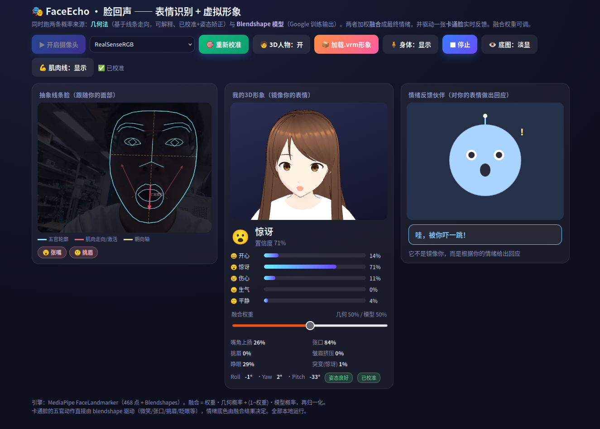

# FaceEcho · 脸回声

> 用摄像头实时识别你的面部表情与动作，让屏幕上的形象“回应”你的表情。

FaceEcho 是一个纯浏览器端运行的表情识别与虚拟形象应用。打开摄像头，你的
每一个微笑、张嘴、挑眉、眨眼、转头都会被实时捕捉，并同时以三种方式反馈：

1. **抽象线条脸** —— 把你的脸抽象成椭圆轮廓 + 五官线条 + 面部肌肉走向线，实时跟随。
2. **虚拟形象** —— 中间默认一张“Q 版卡通脸”镜像你的动作；点「🧑 3D人物」可切换成一个
   **3D 动漫形象（VRM）**，跟着你眨眼 / 张嘴 / 微笑 / 转头（VTuber 那种）。
3. **情绪反馈伙伴** —— 它不镜像你，而是对你的**情绪**做出回应：你开心它替你高兴，
   你难过它来安慰你。

表情判断融合了两条概率来源：**几何法**（基于关键点几何，带中性脸校准、头部姿态矫正、
动态特征，可解释）与 **Blendshape 深度学习模型**（MediaPipe 训练输出），两者加权融合。

> 🔒 人脸识别与分析**全部在访问者的浏览器本地运行**（MediaPipe FaceLandmarker 深度模型 +
> WASM 推理），视频不会上传服务器；服务器只负责把网页发出去。

## 效果预览

**卡通脸模式（默认）** —— 中间一张 Q 版卡通脸镜像你的动作：

| 开心 😄 | 惊讶 😮 |
|:---:|:---:|
|  |  |

**3D 形象模式** —— 点「🧑 3D人物」切换成 VRM 动漫形象，跟着你眨眼/张嘴/转头：

| 开心 😄 | 惊讶 😮 |
|:---:|:---:|
|  |  |

---

## 环境准备（只需一次）

需要 Python 3.8+。安装依赖：

```bash
pip install -r requirements.txt
```

---

## 场景一：本地 + 普通摄像头（最简单）

适用于笔记本自带摄像头、或普通 USB 网络摄像头。

**要启动的东西：只有 1 个 —— 网页服务器。**

```bash
python app.py
```

看到 `FaceEcho 已启动： http://localhost:8002` 后，浏览器打开：

```
http://localhost:8002
```

点「开启摄像头」→ 允许权限 → 页面会自动选到你的摄像头。完成。

> 首次运行会自动下载识别模型 `face_landmarker.task`（约 3.6MB，需要能访问
> storage.googleapis.com）。也可以直接用 `bash run.sh` 一键完成“装依赖 + 下模型 + 启动”。

---

## 场景二：本地 + Intel RealSense（Linux）

浏览器在 Linux 上**读不到 RealSense 的原始流**（Chrome 会去开它的深度节点而报
`Starting videoinput failed`）。解决办法：用 `v4l2loopback` 建一个“虚拟摄像头”，
把 RealSense 的**彩色流**喂进去，浏览器就能像普通摄像头一样用它。

**要启动的东西有 3 个：① 虚拟摄像头喂流（ffmpeg）② 网页服务器 ③ 用 Firefox 打开。**

### 1) 安装工具（只需一次）

```bash
sudo apt install ffmpeg v4l-utils v4l2loopback-dkms
```

### 2) 找到 RealSense 的彩色节点

```bash
for d in 0 1 2 3 4 5; do echo "=== /dev/video$d ==="; v4l2-ctl -d /dev/video$d --list-formats 2>/dev/null | grep -E "YUYV|Z16|GREY"; done
```

显示 **YUYV** 的那个就是彩色节点（通常是 `/dev/video4`；Z16=深度、GREY=红外，用不了）。
下面命令都按 `/dev/video4` 写，如果你的不是这个数字，自行替换。

### 3) 建虚拟摄像头（每次开机后一次；需要 sudo）

```bash
sudo modprobe v4l2loopback video_nr=10 card_label="RealSenseRGB" exclusive_caps=1
```

### 4) 把彩色流喂进虚拟摄像头（**这个终端要一直开着**）

```bash
ffmpeg -use_wallclock_as_timestamps 1 -f v4l2 -input_format yuyv422 \
  -video_size 640x480 -framerate 30 -i /dev/video4 \
  -pix_fmt yuyv422 -f v4l2 /dev/video10
```

刷到 `frame= ... fps=30` 不停就是正常，别关这个窗口。

### 5) 启动网页服务器（另开一个终端）

```bash
python app.py
```

### 6) 用 Firefox 打开并选对摄像头

⚠️ **必须用 Firefox**（Chrome 在 Linux 下认不到这个虚拟摄像头）。打开
`http://localhost:8002` → 点「开启摄像头」→ Firefox 会弹权限框，在“**要共享的摄像头**”
下拉里选 **RealSenseRGB** → 允许。

> 一键法：`bash run.sh` 检测到 RealSense 时，会自动完成第 3、4 步（建虚拟摄像头 + 后台喂流），
> 你只需第 6 步用 Firefox 选 RealSenseRGB。
> 常见问题：如果“没有 RealSenseRGB”或画面黑，多半是第 4 步的 ffmpeg 停了，重跑一遍即可
> （先关掉占用摄像头的浏览器标签再重启喂流）。

---

## 场景三：生成外网网址（让别人也能用）

本地运行只有你这台电脑能开。要给外面的人一个网址，需要把本地服务“隧道”到公网。
最简单用 **ngrok**（自带 HTTPS，正好满足浏览器开摄像头必须 HTTPS 的要求）。

**前提**：`python app.py` 已在运行（场景一或二里那个服务器保持开着）。

```bash
# 1) 去 https://dashboard.ngrok.com 注册，拿到 authtoken，配置一次
./ngrok config add-authtoken 你的authtoken

# 2) 开隧道（这个终端也要一直开着）
./ngrok http 8002
```

ngrok 会显示一行：

```
Forwarding  https://xxxx-xx-xx.ngrok-free.dev -> http://localhost:8002
```

把那个 **https 网址**发给别人即可。要点：

- 访客第一次打开会看到 ngrok 的蓝色提示页，点 **Visit Site** 即进入。
- 访客用的是**他们自己的摄像头**，识别在他们浏览器本地跑，视频不经过你的电脑。
- **你的电脑、`python app.py`、`ngrok` 三者都要一直开着**，关掉任一个网址就失效。
- 免费版每次重启 ngrok 网址会变；想要固定网址可用 ngrok 付费版或换 Cloudflare Tunnel。

---

## 使用步骤（打开页面后）

1. 点「开启摄像头」，允许摄像头权限（RealSense 用户在 Firefox 权限框选 `RealSenseRGB`）。
2. 正对镜头、放松表情，点「🎯 校准中性脸(3秒)」——保持自然脸 3 秒（**显著提升准确度**）。
3. 做各种表情，三个视图会实时反馈。
4. 想要 3D 形象，点「🧑 3D人物」切换；「📦 加载.vrm形象」可换成你自己的 VRM。

## 换一个 3D 形象

默认形象是一个 VRM 示例。想换成自己喜欢的：

- 用免费的 **VRoid Studio** 捏一个动漫角色导出 `.vrm`，或到 **VRoid Hub / BOOTH** 下载免费 VRM；
- 把文件替换为 `static/models/avatar.vrm`，或在页面点「📦 加载.vrm形象」临时加载。

## 目录结构

```
faceecho/
├── app.py                 # Flask 服务器（仅静态托管）
├── requirements.txt
├── run.sh                 # 一键启动（装依赖 + 下模型 + 检测 RealSense + 起服务）
├── get_model.sh           # 单独下载识别模型
├── README.md
├── ATTRIBUTION.md         # 第三方资源与许可
├── docs/                  # README 用的截图
└── static/
    ├── index.html         # 主应用（三视图）
    ├── avatar3d.html      # 独立的纯 3D 形象页（可选）
    ├── models/
    │   └── avatar.vrm     # 示例 3D 形象
    └── mediapipe/         # 离线识别运行时（WASM）
```

## 技术栈

- 后端：Flask（仅静态托管）
- 识别：MediaPipe Tasks Vision — FaceLandmarker（浏览器端深度学习推理）
- 渲染：Canvas 2D（线条脸/卡通脸/伙伴）+ three.js & @pixiv/three-vrm（3D 形象）

第三方资源与许可见 `ATTRIBUTION.md`。
